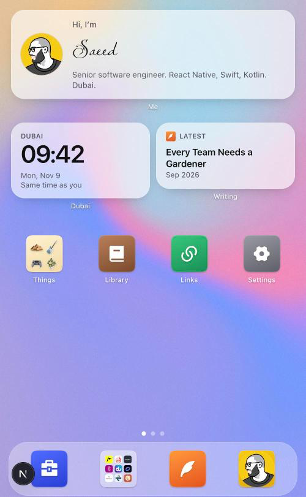
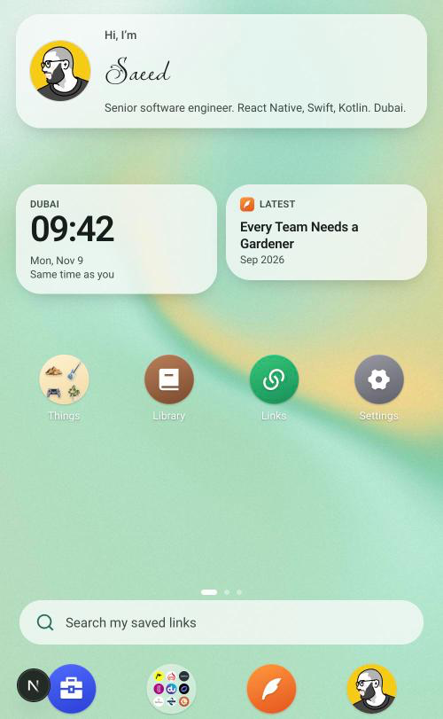

<div align="center">

# Saeed

**A personal site that is a phone.**

### [thisissaeed.com →](https://thisissaeed.com)

</div>

<p align="center">
	<picture>
		<source media="(prefers-color-scheme: dark)" srcset=".github/readme/mobile-dark.png" />
		
	</picture>
</p>

I'm Muhammed Ibrahim, a software engineer who works mostly in React Native. The apps I build live on phones, so the site does too: on a desktop it stands in a room beside a few lines about me; on a phone it fills the screen and becomes the phone you are holding.

## What's on the phone

**Three home-screen pages.** The first is about me: a widget with my face and title, the time in Dubai, and my latest post. The second holds the apps I shipped at work, Thndr, dubizzle cars, Nomo, Breadfast, du, Growth, Bird Nest, and Bynh, each opening to a screen with what I did on it and where to get it. The third holds my own apps, from Azkarify and Trove to PewPew and Kudzu.

**Eight apps of my own making.** Work is my history, Apps the sixteen apps above, Writing the blog, Things the eight objects that say something about me with the stories behind them, Library the shelf of books you can still pull out, Links the saved links, Me the contact sheet, and Settings the phone's settings, which are the site's settings.

**Pick a platform.** The switch beside the phone, and in Settings, re-dresses the whole thing. iOS gets the Dynamic Island, squircles, inset grouped lists, and SF or Inter. Android gets a punch-hole camera, round icons, Material lists, Roboto, and the search pill. Web drops the phone and lays the same screens out as a plain page. One codebase, three platforms, the way a React Native engineer would want it.

<p align="center">
	
</p>

**Small things.** The phone tilts toward your pointer. The wallpaper is a live mesh gradient. Press the side button and it locks, with the latest posts as notifications. Open an app and it zooms out of its icon. Links tick under your cursor, and the speaker in the side panel mutes it all.

## Reading

Posts open outside the phone in a full-width reader, with a way back into the Writing app.

---

<details>
<summary>Run it locally</summary>

```bash
bun install
bun dev
```

Then open the URL the dev server prints.

</details>
