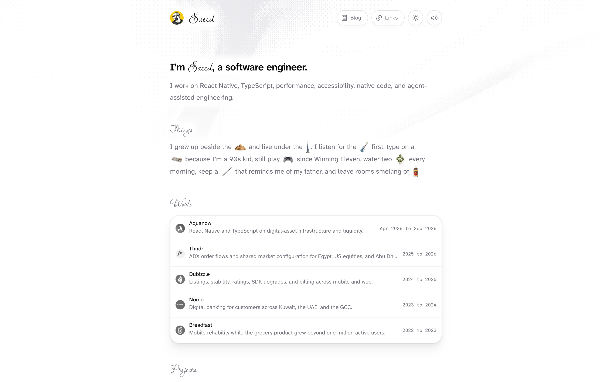
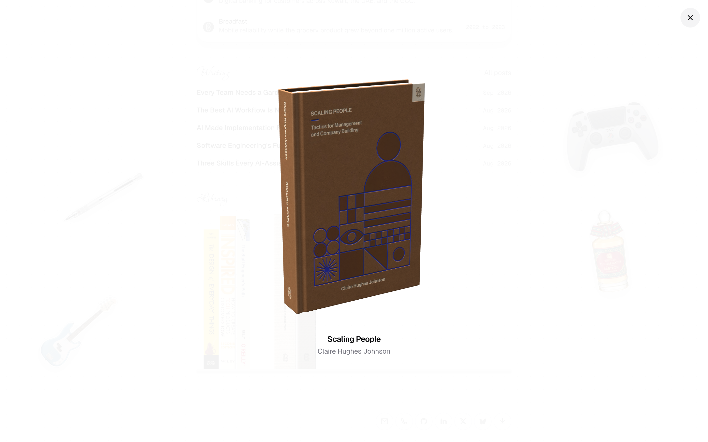
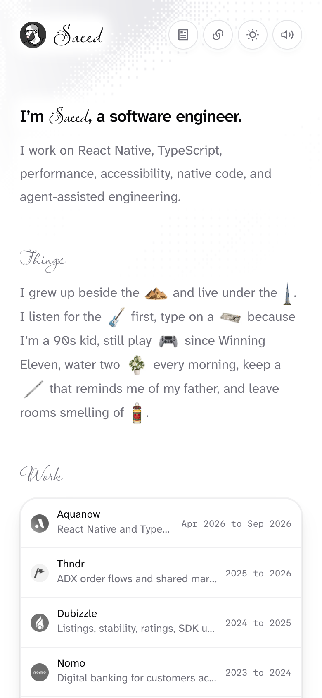

<div align="center">

# Saeed

**A personal site you can pick things up from.**

### [thisissaeed.com →](https://thisissaeed.com)

</div>

<picture>
	<source media="(prefers-color-scheme: dark)" srcset=".github/readme/hero-dark.png" />
	
</picture>

I'm Muhammed Ibrahim, a software engineer who works mostly in React Native. This is my corner of the internet. It has the usual parts: who I am, where I've worked, and what I've written. It also has a few things to play with.

## What's on the page

**Eight things, in one sentence.** The pyramids, the Burj Khalifa, a bass guitar, a mechanical keyboard, a PlayStation controller, a monstera, a Uni pencil, and a bottle of Babylon perfume sit in a sentence about me, each one standing in for its noun like a small icon. Hover one and it leans in.

**A shelf of books you can pull out.** *The Design of Everyday Things*, *Inspired*, *The Staff Engineer's Path*, *Scaling People*, *An Elegant Puzzle*, and *Where Is My Flying Car?*. Pick one off the shelf, turn it over in your hand, then let it go and watch it slide back into place.

<p align="center">
	
</p>

**A page that answers back.** Links tick under your cursor. The face next to my name follows your pointer with its eyes. The dot grid behind everything moves out of your way. The speaker in the header mutes it all if you'd rather read in silence.

**The rest of me.** Five companies I've shipped apps for, from Breadfast to Aquanow. Twelve posts on React Native and building software with coding agents. A list of 94 links I keep coming back to. Six side projects, like Azkarify and Trove.

## On your phone too

Everything wraps to a small screen, the sentence of things included.

<p align="center">
	
</p>

<div align="center">

### Come say hi: [thisissaeed.com](https://thisissaeed.com)

</div>

---

<details>
<summary>Run it locally</summary>

```bash
bun install
bun dev
```

Then open the URL the dev server prints.

</details>
